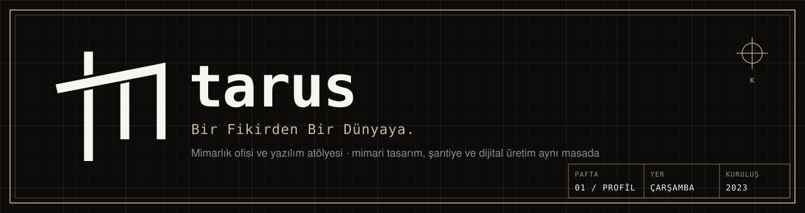
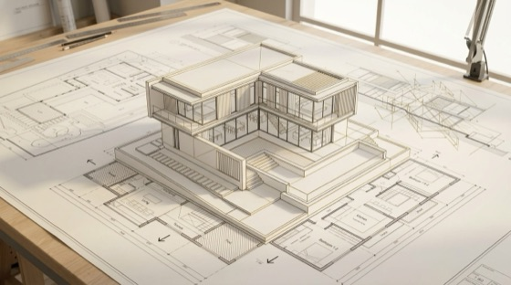
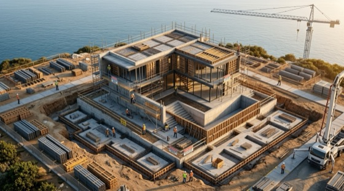

<picture>
  <source media="(prefers-color-scheme: dark)" srcset="assets/banner-koyu.svg">
  <source media="(prefers-color-scheme: light)" srcset="assets/banner-acik.svg">
  
</picture>

  
  
  
  

<table>
  <tr>
    <td width="25%"></td>
    <td width="25%"></td>
    <td width="25%"></td>
    <td width="25%"></td>
  </tr>
  <tr>
    <td align="center"><b>01</b> · ÇİZİM</td>
    <td align="center"><b>02</b> · MAKET</td>
    <td align="center"><b>03</b> · İNŞAAT</td>
    <td align="center"><b>04</b> · YAŞAM</td>
  </tr>
</table>

Mimari tasarım, şantiye zanaati ve dijital üretimi aynı masada buluşturan bir mimarlık ofisiyiz.
Ofiste her gün kullandığımız araçları kendimiz yazıyoruz: proje ve ruhsat takibinden arşive, sunum paftasından
BIM modeline kadar. Hepsi tek hesapla birbirine bağlı çalışır; bir kısmını herkesin kullanımına açıyoruz.

### ◢ Ofis ve proje yönetimi

<table>
  <tr>
    <td width="50%" valign="top">
      <h4><a href="https://tarus.tr/yazilim/pusula">Pusula</a></h4>
      Mimarlık ofisleri için proje, ruhsat, teklif, şantiye ve arşiv yönetimi.
      Yönetmelik denetimini Refik kural motoruyla yapar. Web · iOS · Android
    </td>
    <td width="50%" valign="top">
      <h4><a href="https://arkiv.tarus.tr">Arkiv</a></h4>
      Proje dosyaları için bulut depolama ve arşiv: klasörler, önizleme, paylaşım,
      ofis belgelerini tarayıcıda düzenleme. Web · App Store'da
    </td>
  </tr>
  <tr>
    <td valign="top">
      <h4><a href="https://not.tarus.tr">Not</a></h4>
      El yazısı not ve eskiz: kalem, fosforlu kalem, desenler; cihazlar arasında
      otomatik eşitleme. Web · iOS · Android
    </td>
    <td valign="top">
      <h4>Belge</h4>
      Word, Excel, PowerPoint ve PDF dosyalarını Arkiv, Posta ve Pusula içinden açıp
      birlikte düzenleme.
    </td>
  </tr>
</table>

### ◢ Tasarım ve üretim

<table>
  <tr>
    <td colspan="2" valign="top">
      <h4><a href="https://arkimetre.com">Arkimetre</a></h4>
      Tarayıcıda çalışan, Türk mevzuatına uygun BIM tasarım programı. İmar ve yönetmelik denetimini
      Refik kural motoruyla anında yapar; hızlı paftalama ve ölçülendirme, bağımsız bölüm tanımı,
      hazır tefriş kütüphanesi ve Türkçe, sade bir arayüz sunar. Kurulum gerektirmez. Web
    </td>
  </tr>
  <tr>
    <td width="50%" valign="top">
      <h4><a href="https://pafta.tarus.tr">Pafta</a></h4>
      Sosyal medya için sunum paftası: hazır şablonlar, ortak çalışma alanı, yayın takvimi, Reels.
    </td>
    <td width="50%" valign="top">
      <h4><a href="https://model.tarus.tr">Model</a></h4>
      BIM modellerini tarayıcıda görüntüleme, pafta ve görünüm paylaşma.
    </td>
  </tr>
  <tr>
    <td valign="top">
      <h4>Revit eklentileri</h4>
      <b>View Template</b> ile görünüm şablonu yönetimi, <b>Sheet Exporter</b> ile toplu pafta dışa aktarımı.
    </td>
    <td valign="top">
      <h4>CAD &amp; Revit Translator</h4>
      DXF bloklarını, özniteliklerini ve metinlerini; RFA/RVT parametrelerini Türkçeye çevirir.
    </td>
  </tr>
  <tr>
    <td valign="top">
      <h4>Çizge</h4>
      DWG ve DXF dosyalarını dönüştüren çizim servisi; diğer uygulamalara altyapı sağlar.
    </td>
    <td valign="top">
      <h4>Mevzuat takibi</h4>
      İmar ve yapı yönetmeliği değişikliklerini, sektör haberlerini tek akışta toplar.
    </td>
  </tr>
</table>

### ◢ Sektörlere yönelik

| Ürün | |
|---|---|
| **Pazarlama** | Saha temsilcileri ve plasiyerler için sipariş, tahsilat, gider ve muhasebe yönetimi |
| **Klinik** | Diş hekimleri ve ağız-diş sağlığı klinikleri için klinik yönetimi |
| **Kurumsal siteler** | 7 sektörde 35 hazır kurumsal web sitesi şablonu |

### ◢ Açık kaynak

| Repo | | Platform |
|---|---|---|
| [**not-mobil**](https://github.com/tarusatolye/not-mobil) | El yazısı not ve eskiz uygulaması ([Saber](https://github.com/saber-notes/saber) tabanlı, GPL-3.0) | iOS · Android |
| [**indirme-yoneticisi**](https://github.com/tarusatolye/indirme-yoneticisi) | Tarayıcı eklentili indirme yöneticisi | macOS · Windows |
| [**sikistirma-yoneticisi**](https://github.com/tarusatolye/sikistirma-yoneticisi) | Arşiv sıkıştırma ve açma aracı | macOS · Windows |

### ◢ Nasıl yapıyoruz

- **Arka uç:** Python, Django, Django REST Framework, PostgreSQL, Redis
- **Web:** React, Vite, Tailwind
- **Mobil:** React Native (Expo), Flutter
- **Masaüstü ve CAD:** Swift, C# / .NET, Revit API
- **Altyapı:** kendi sunucularımız; tek oturum açma (SSO), S3 uyumlu depolama, ONLYOFFICE

### ◢ İletişim

<a href="https://tarus.tr">tarus.tr</a> · <a href="mailto:bilgi@tarus.tr">bilgi@tarus.tr</a> · <a href="mailto:yazilim@tarus.tr">yazilim@tarus.tr</a>

PAFTA 02 · ÖLÇEK 1/1 · ÇARŞAMBA, SAMSUN
