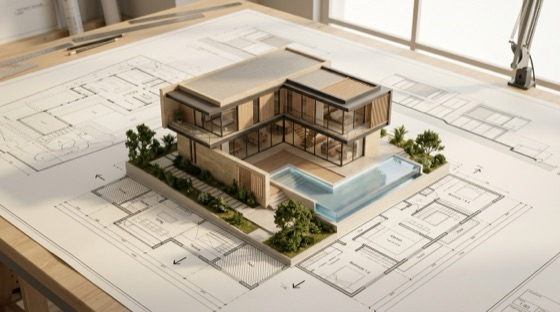
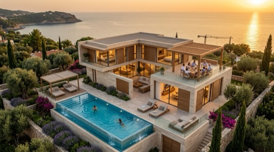

<picture>
  <source media="(prefers-color-scheme: dark)" srcset="assets/banner-koyu.svg">
  <source media="(prefers-color-scheme: light)" srcset="assets/banner-acik.svg">
  
</picture>

  
  
  
  

<table>
  <tr>
    <td width="25%"></td>
    <td width="25%"></td>
    <td width="25%"></td>
    <td width="25%"></td>
  </tr>
  <tr>
    <td align="center"><b>01</b> · ÇİZİM</td>
    <td align="center"><b>02</b> · MAKET</td>
    <td align="center"><b>03</b> · İNŞAAT</td>
    <td align="center"><b>04</b> · YAŞAM</td>
  </tr>
</table>

Mimari tasarım, şantiye zanaati ve dijital üretimi aynı masada buluşturan bir mimarlık ofisiyiz.
Ofiste her gün kullandığımız araçları kendimiz yazıyoruz; bir kısmını herkesin kullanımına açıyoruz.

### ◢ Ürünler

<table>
  <tr>
    <td width="50%" valign="top">
      <h4><a href="https://tarus.tr/yazilim/pusula">Pusula</a></h4>
      Mimarlık ofisleri için proje, ruhsat, teklif, şantiye ve arşiv yönetimi.
    </td>
    <td width="50%" valign="top">
      <h4><a href="https://pafta.tarus.tr">Pafta</a></h4>
      Sosyal medya için sunum paftası: hazır şablonlar, yayın takvimi, Reels.
    </td>
  </tr>
  <tr>
    <td valign="top">
      <h4><a href="https://tasarla.tarus.tr">Tasarla</a></h4>
      Tarayıcıda 2B tefriş ve 3B mekân tasarımı. Hesap gerektirmez.
    </td>
    <td valign="top">
      <h4><a href="https://model.tarus.tr">Model</a></h4>
      BIM modellerini tarayıcıda görüntüleme, pafta ve görünüm paylaşma.
    </td>
  </tr>
</table>

### ◢ Açık kaynak

| Repo | |
|---|---|
| [**not-mobil**](https://github.com/tarusatolye/not-mobil) | El yazısı not ve eskiz uygulaması (mobil) |
| [**indirme-yoneticisi**](https://github.com/tarusatolye/indirme-yoneticisi) | macOS ve Windows için indirme yöneticisi |

### ◢ İletişim

<a href="https://tarus.tr">tarus.tr</a> · <a href="mailto:destek@tarus.tr">destek@tarus.tr</a>

PAFTA 01 · ÖLÇEK 1/1 · ÇARŞAMBA, SAMSUN
